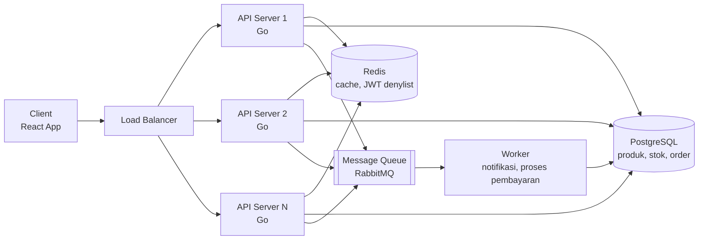

# Fullstack Work Sample Test

**Nama:** Muhammad Sinan Abdussyakur<br>
**Posisi:** System Developer<br>
**Tanggal:** 8 Oktober 2026

---

## Cara Menjalankan Aplikasi

Aplikasi untuk Soal 1 berada di folder [`product-dashboard/`](./product-dashboard).

**Prasyarat:** Node.js 18+

```bash
cd product-dashboard
npm install
npm run dev
```

Buka `http://localhost:5173` di browser.

---

## Soal 1: Optimasi Performa & State Management React (Live Coding / Implementation)

### 1.1 Jelaskan penyebab utama unnecessary re-render pada React saat menangani dataset besar.

Menurut saya penyebab utamanya adalah karena semua data produk disimpan di satu state pada parent component, sehingga saat ada satu item yang berubah, parent-nya akan re-render dan semua row di bawahnya juga ikut re-render, walaupun datanya tidak berubah. Selain itu, function yang dikirim ke setiap row juga dibuat ulang di setiap render (misalnya `onClick={() => onUpdate(id)}`), sehingga React menganggap props-nya berubah. Sementara itu, 5.000 row-nya juga di-render semua ke DOM, padahal yang terlihat oleh user hanya belasan row saja, sehingga hal tersebut membuat proses render-nya menjadi berat.

### 1.2 Implementasikan contoh React Component (Gunakan Hook seperti useMemo, useCallback, React.memo, atau Virtualization seperti react-window) di dalam file README / folder /src.

Untuk implementasinya, saya membuat mini app yang ada di folder [`product-dashboard/src`](./product-dashboard/src). Disini ada dua mode yang bisa dibandingkan, yaitu Naive (sebelum optimasi) dan Optimized, dan juga ada counter untuk melihat berapa row yang di-render saat ada update.

`react-window` disini digunakan untuk virtualization, karena memang hanya row yang terlihat di layar saja yang perlu di-render ke DOM. Sementara itu, `React.memo` digunakan pada row agar tidak ikut re-render saat parent-nya re-render, dan `useCallback` digunakan agar function pada row tidak dibuat ulang di setiap render. Untuk `useMemo` sendiri digunakan pada hasil filter pencarian, agar tidak dihitung ulang terus-menerus.

```jsx
const ProductRow = memo(function ProductRow({ id, style }) {
  const product = useProductStore((state) => state.byId[id])
  const changeStock = useProductStore((state) => state.changeStock)

  const decrease = useCallback(() => changeStock(id, -1), [id, changeStock])
  const increase = useCallback(() => changeStock(id, 1), [id, changeStock])

  return (
    <div className="row" style={style}>
      <span>{product.name}</span>
      <span>{product.stock}</span>
      <button onClick={decrease}>−</button>
      <button onClick={increase}>+</button>
    </div>
  )
})
```

```jsx
export default function ProductTable({ query }) {
  const ids = useProductStore((state) => state.ids)

  const visibleIds = useMemo(() => {
    const keyword = query.trim().toLowerCase()
    if (!keyword) return ids
    return ids.filter((id) => nameById[id].includes(keyword))
  }, [ids, query])

  return (
    <List height={528} width="100%" itemCount={visibleIds.length} itemSize={44} itemData={visibleIds}>
      {Row}
    </List>
  )
}
```

Berikut hasilnya dengan 5.000 produk, saat stok dari satu item diubah:

| | Naive | Optimized |
|---|---|---|
| Row yang di-render ke DOM | 5.000 | 14 |
| Row yang re-render saat 1 item berubah | 5.000 | 1 |

### 1.3 Jelaskan strategi state management yang tepat agar update item individual tidak memicu re-render global.

Menurut saya, strategi yang tepat adalah memisahkan state dari parent component dan membuat setiap row hanya subscribe ke datanya sendiri. Disini saya menggunakan Zustand dengan state yang dinormalisasi, yaitu `ids` untuk menyimpan urutan produk dan `byId` untuk menyimpan data setiap produk. Saat stok satu produk berubah, hanya object produk tersebut yang diganti, sehingga hanya row yang subscribe ke produk tersebut yang re-render. Tabelnya sendiri hanya subscribe ke `ids`, dan karena `ids` tidak berubah saat stok di-update, tabelnya tidak ikut re-render.

```js
export const useProductStore = create((set) => ({
  ids: initialProducts.map((p) => p.id),
  byId: Object.fromEntries(initialProducts.map((p) => [p.id, p])),

  changeStock: (id, delta) =>
    set((state) => {
      const product = state.byId[id]
      const stock = Math.max(0, product.stock + delta)
      return { byId: { ...state.byId, [id]: { ...product, stock } } }
    }),
}))
```

---

## Soal 2: Arsitektur Backend, Autentikasi JWT, & High-Concurrency Scaling

### 2.1 Bebas memilih tech stack Backend. Sebutkan pilihan Anda dan berikan alasannya.

Menurut saya stack yang cocok dan saya akan gunakan pada skenario ini adalah Golang + PostgreSQL + Redis. Golang disini digunakan karena memiliki goroutine yang dapat menghandle ribuan request dengan resource yang kecil. Sementara itu, PostgreSQL digunakan sebagai database karena memang cocok dengan e-commerce yang membutuhkan relational database, dan juga PostgreSQL juga memiliki row-level locking, sehingga pada skenario flash sale yang diakses banyak user secara bersamaan tetap dapat menjaga integritas data (ACID). Untuk Redis sendiri digunakan untuk caching data-data yang sering diakses, seperti content dari flash salenya sendiri yang akan diakses berkali-kali dan juga dapat digunakan untuk menyimpan denylist token JWT.

### 2.2 Bagaimana Anda menangani mekanisme Token Revocation (Logout / Invalidation) pada JWT tanpa merusak sifat stateless dari JWT itu sendiri?

Sebenarnya untuk skenario seperti ini tidak bisa fully stateless, harus ada yang disimpan/lookup untuk men-deny token tersebut. Mekanisme yang saya pikirkan adalah menambahkan token id (`jti`) ke dalam token-nya, kemudian ketika user tersebut logout, token id akan disimpan ke dalam Redis dengan expiry yang sama dengan sisa umur token-nya, sehingga data di Redis akan terhapus sendiri dan deny-list-nya tetap kecil. Lalu ketika ada yang menggunakan token yang sama, aplikasi akan melihat ke Redis untuk cek deny-list terlebih dahulu.

Selain itu, access token-nya dibuat berumur pendek (misalnya 15 menit) dan dipasangkan dengan refresh token yang disimpan di server, sehingga saat logout refresh token-nya dihapus dan user tidak bisa mendapatkan access token baru. Dengan hal ini, verifikasi token (signature dan expiry) tetap stateless, dan yang disimpan hanya daftar kecil token yang di-revoke.

### 2.3 Jelaskan strategi penanganan 'Race Condition' saat 100 user membeli 1 sisa barang yang sama secara bersamaan pada database SQL / NoSQL pilihan Anda.

Untuk case seperti ini, lock di level aplikasi (seperti mutex) tidak cukup, karena server-nya lebih dari satu, sehingga lock-nya harus berada di database yang digunakan bersama oleh semua server. Disini saya akan menggunakan transaction dengan row-level lock (`FOR UPDATE`), sehingga request pertama akan mengunci row produk tersebut dan 99 request lainnya harus menunggu sampai transaction-nya selesai.

```sql
BEGIN;
SELECT stock FROM products WHERE id = $1 FOR UPDATE;
UPDATE products SET stock = stock - $2 WHERE id = $1 AND stock >= $2;
INSERT INTO orders (...) VALUES (...);
COMMIT;
```

`$1` adalah id produk dan `$2` adalah jumlah yang dibeli. Kondisi `stock >= $2` memastikan stok tidak akan menjadi minus, sehingga jika tidak ada row yang ter-update, artinya stoknya sudah habis dan transaction-nya akan di-rollback. Dengan hal ini, hanya 1 dari 100 user yang berhasil membeli, dan 99 lainnya akan mendapatkan response bahwa stoknya habis.

### 2.4 Sertakan diagram alur ringkas (Text / Mermaid.js) untuk arsitektur backend yang Anda usulkan.



Request dari client masuk ke load balancer dan dibagi ke beberapa API server yang stateless. Setiap server menggunakan Redis untuk cache dan deny-list JWT, dan PostgreSQL untuk data produk, stok, dan order. Proses yang tidak perlu ditunggu oleh user (seperti notifikasi) dikirim ke message queue dan dikerjakan oleh worker, sehingga response ke user tetap cepat.

---

## Soal 3: Strategi Integrasi API, Webhook Reliability, & Resiliency

### 3.1 Rancang mekanisme 'Idempotency' pada endpoint Webhook backend Anda agar transaksi tidak terproses ganda.

Untuk case ini, saya menggunakan `event_id` dari payment gateway sebagai idempotency key, yang disimpan ke tabel `webhook_events` dengan UNIQUE constraint. Sehingga jika webhook yang sama dikirim dua kali (bahkan secara bersamaan ke server yang berbeda), hanya satu yang berhasil tersimpan dan diproses. Webhook yang duplikat tetap dibalas dengan 200 agar payment gateway berhenti retry. Selain itu, status order juga hanya di-update jika masih `pending`, sebagai pengaman kedua.

```go
func HandlePaymentWebhook(w http.ResponseWriter, r *http.Request) {
    // read raw body
    body, err := io.ReadAll(r.Body)
    if err != nil {
        respond(w, http.StatusBadRequest, "invalid body")
        return
    }

    // verify signature from the payment gateway
    signature := r.Header.Get("X-Signature")
    if signature == "" || !verifySignature(signature, body, secretKey) {
        respond(w, http.StatusUnauthorized, "invalid signature")
        return
    }

    // decode event
    var event PaymentEvent
    if err := json.Unmarshal(body, &event); err != nil {
        respond(w, http.StatusBadRequest, "invalid body")
        return
    }

    tx := db.Begin()
    defer tx.Rollback()

    // idempotency check from event id
    inserted := tx.Exec(`
        INSERT INTO webhook_events (event_id, order_id, received_at)
        VALUES ($1, $2, now())
        ON CONFLICT (event_id) DO NOTHING
    `, event.ID, event.OrderID)
    if inserted.RowsAffected() == 0 {
        respond(w, http.StatusOK, "already processed")
        return
    }

    // update status only if the status = pending
    updated := tx.Exec(`
        UPDATE orders
        SET status = 'paid', paid_at = now()
        WHERE id = $1 AND status = 'pending'
    `, event.OrderID)

    if err := tx.Commit(); err != nil {
        respond(w, http.StatusInternalServerError, "failed to process")
        return
    }

    // publish to the queue only after the commit succeeds
    if updated.RowsAffected() == 1 {
        queue.Publish("order.paid", event.OrderID)
    }

    respond(w, http.StatusOK, "ok")
}
```

> Kode di atas disederhanakan untuk menunjukkan alur idempotency-nya, sehingga error handling pada setiap query tidak ditulis.

### 3.2 Jelaskan strategi fallback/retry mechanism (misal: Cron Job / Polling / Dead Letter Queue) untuk memverifikasi pembayaran yang menggantung.

Untuk case ini, kita dapat menggunakan retry mechanism yang biasanya sudah disediakan oleh payment gateway. Saat proses dari endpoint webhook gagal, server akan membalas dengan 5xx agar payment gateway retry secara berkala (hal ini dapat dilakukan karena endpoint-nya sudah idempotent).

Namun retry tersebut tidak menangani case dimana webhook-nya tidak pernah sampai sama sekali, sehingga kita juga perlu menambahkan cron job yang berjalan secara berkala untuk cek order yang masih pending terlalu lama, lalu menanyakan status dari payment tersebut ke API payment gateway. Jika ternyata sudah dibayar, order tersebut akan diproses dengan logic idempotent yang sama seperti di webhook.

Selain itu, kita juga bisa menambahkan batas waktu pembayaran, sehingga payment process yang melebihi x-waktu akan ditandai sebagai gagal dan tidak bisa dilanjutkan, dan data akan dikembalikan ke state sebelum adanya order. Tetapi, sistem akan memastikan dulu ke payment gateway bahwa pembayaran memang belum dilakukan, agar order yang sebenarnya sudah dibayar tidak ikut dibatalkan.

### 3.3 Bagaimana Frontend React mengkomunikasikan status pembayaran ini secara smooth kepada user tanpa perlu terus-menerus membebani server (misal: Polling vs WebSocket vs Server-Sent Events)?

Menurut saya, yang paling cocok adalah Server-Sent Events (SSE). Polling memang paling simple, tetapi FE akan terus-menerus mengirim request walaupun statusnya belum berubah, sehingga membebani server saat user-nya banyak. Sementara itu, untuk mengetahui status pembayaran hanya diperlukan komunikasi satu arah (server -> client), sehingga penggunaan WebSocket yang dua arah terlalu berlebihan.

Alurnya adalah saat user menunggu pembayaran, FE akan membuka koneksi SSE ke backend, dan ketika webhook dari payment gateway sudah masuk dan status order telah berubah, backend akan mengirim event terbaru ke FE, lalu FE akan menampilkan "Pembayaran Berhasil". Sebagai fallback, saat halaman pertama kali dibuka atau koneksinya terputus, FE akan memanggil endpoint status order satu kali untuk mengambil status terbaru.

---

## Soal 4: Evaluasi TCO (Total Cost of Ownership) & Trade-off Monolith vs Microservices

### 4.1 Lakukan analisis Total Cost of Ownership (TCO): Apakah migrasi ini secara bisnis menguntungkan untuk startup skala awal-menengah?

Tidak, untuk mengimplementasikan microservices, diperlukan cost yang sangat tinggi, dan juga jika dilihat dari budget $150 sendiri dapat dibilang mungkin user dari aplikasi tersebut memang masih sedikit, sehingga arsitektur monolith masih cocok untuk digunakan. Untuk melakukan refactor tersebut akan menyita seluruh waktu seluruh tim dan juga development dari project tersebut, dan juga untuk migrasi ke microservices sendiri cukup sulit, perlu tracing antar services, debugging jadi semakin sulit, dan juga data consistency jadi semakin rumit. Jika user countnya memang belum banyak dan current monolith architecture masih memadai, microservices tidak dibutuhkan.

### 4.2 Sebutkan hidden costs (biaya tersembunyi) dari arsitektur Microservices, baik dari segi infrastruktur maupun operational effort tim engineering.

**Infrastruktur:**
- Biaya Kubernetes control plane dan worker node yang harus selalu menyala walaupun traffic sedang sepi.
- Load balancer, NAT gateway, dan biaya transfer data antar service.
- Setiap service membutuhkan database-nya sendiri.
- Tools untuk monitoring, centralized logging, dan distributed tracing.
- Biaya Lambda yang ikut naik seiring bertambahnya traffic.

**Operational effort tim engineering:**
- Dibutuhkan orang yang memahami Kubernetes, baik dengan merekrut DevOps maupun mengambil waktu developer dari pengerjaan fitur.
- Debugging menjadi lebih sulit karena satu request melewati banyak service.
- Setiap service memerlukan CI/CD pipeline sendiri.
- Menjaga konsistensi data antar service lebih rumit karena tidak bisa lagi menggunakan satu database transaction.
- Developer baru membutuhkan waktu lebih lama untuk memahami sistem.

### 4.3 Berikan rekomendasi arsitektur kompromi (hybrid / modular monolith) yang paling efisien dari segi biaya infrastruktur dan kecepatan deliver feature.

Rekomendasi saya adalah modular monolith, tetap satu aplikasi dan satu deployment, tapi dibagi menjadi modul-modul dengan boundary yang jelas (misalnya order, payment, catalog), dimana setiap modul memiliki tabelnya sendiri dan hanya berkomunikasi lewat interface. Dengan hal ini, biaya infrastruktur tetap rendah, tim tetap bisa deliver fitur dengan cepat, dan codebase menjadi lebih rapi. Jika suatu saat ada modul yang memang butuh di-scale secara terpisah, modul tersebut dapat dipisahkan menjadi service sendiri dengan effort yang jauh lebih kecil karena batasannya sudah jelas dari awal. Migrasi ke microservices sebaiknya dilakukan bertahap dan hanya dilakukan jika ada kebutuhan yang terukur, seperti traffic yang sangat besar, atau tim yang sudah terlalu besar untuk bekerja di satu codebase.

---

## Soal 5: Prioritisasi Feature, Metrik Software (LTV/CAC), & Handling Tech Debt

### 5.1 Bagaimana Anda sebagai Lead/Senior Developer mengkomunikasikan dampak Technical Debt ini kepada Product Manager dan Stakeholder Non-Teknis?

Saya akan menekankan dampak technical debt yang cukup parah jika tidak diselesaikan secara cepat, tentunya saya akan menggunakan metric-metric non-teknikal seperti, waktu, effort, dan juga uang, dan juga saya akan menyiapkan data mengenai insiden-insiden sebelumnya, seperti downtime berapa lama, estimasi kerugian saat aplikasi down. Tetapi pada akhirnya keputusan masih di tangan stakeholder, sehingga saya akan memberikan pilihan serta konsekuensinya.

### 5.2 Jelaskan hubungan antara kualitas codebase / sistem reliabilitas dengan metrik bisnis seperti Churn Rate dan Customer Lifetime Value (LTV).

Menurut saya, kualitas codebase berpengaruh langsung ke metrik bisnis, karena codebase yang buruk akan membuat sistem sering error atau down, sehingga experience user menjadi buruk dan user berhenti menggunakan produk (churn rate naik), yang akhirnya membuat LTV turun. Hal ini juga berkaitan dengan CAC, dimana biaya yang sudah dikeluarkan untuk mendapatkan user baru akan terbuang sia-sia jika user tersebut langsung pergi karena sistemnya bermasalah. Selain itu, technical debt juga akan memperlambat tim engineering, sehingga fitur berikutnya akan semakin lama untuk dikerjakan.

### 5.3 Berikan framework / langkah prioritisasi konkret untuk membagi kapasitas sprint antara pengerjaan Fitur Bisnis Baru vs Refactoring Technical Debt.

Menurut saya, untuk case ini kita perlu memilah technical debt-nya terlebih dahulu berdasarkan risikonya, karena tidak semua technical debt harus dikerjakan sekarang. Yang berisiko membuat server down atau performance issue akan dikerjakan duluan, sedangkan yang hanya membuat code kurang rapi bisa ditunda. Selain itu, kita juga bisa memprioritaskan perbaikan di bagian yang memang akan disentuh oleh fitur baru, sehingga refactoring-nya bisa dikerjakan bersamaan dengan fiturnya, atau juga bisa berdiskusi dengan Product Manager untuk mengurangi scope, misalnya hanya 2 dari 3 fitur yang di-release di sprint ini. Untuk pembagian kapasitasnya sendiri, karena kondisinya sedang kritis, saya akan menggunakan 50% untuk fitur baru, 40% untuk technical debt, dan 10% untuk buffer, lalu setelah technical debt yang kritis selesai, porsinya dikembalikan ke normal (70% fitur, 20% technical debt, 10% buffer), sehingga technical debt-nya tidak menumpuk lagi.